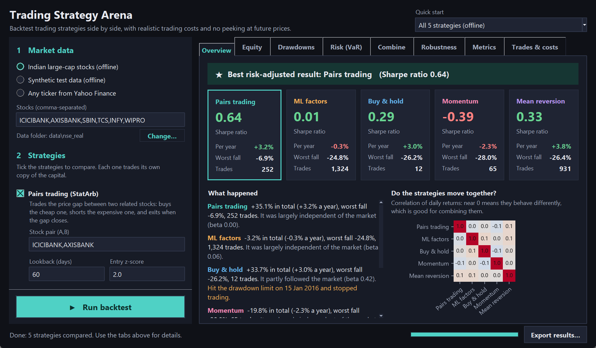

# Trading Strategy Arena
### Quantitative Backtesting & Signal Engine

An **event-driven backtesting engine** in Python with a **Tkinter GUI** that
benchmarks multiple trading "agents" head-to-head, models realistic
market frictions (slippage, transaction cost analysis, execution
latency) to eliminate look-ahead bias, and evaluates **StatArb** and
**multi-factor ML** signals on Sharpe ratio, Alpha/Beta, and rolling VaR.



No external data or API keys required by default — a bundled real
historical dataset (10 NSE large-cap stocks, 2011-2021, split/bonus
adjusted) and a synthetic multi-asset generator (GARCH-style vol
clustering + a cointegrated pair by construction) make the whole project
runnable out of the box. A `yfinance`-backed data handler is also
included for pulling live data on any ticker when you have internet access.

Every claim above is checked by an automated test suite (`tests/`, 54
tests) — see [Verification](#verification).

---

## Data sources

Three interchangeable sources, selectable in the GUI or via the `engine` API:

| Source | What it is | Setup |
|---|---|---|
| **real** (default) | Bundled daily OHLCV for 10 NSE (India) large-caps — ICICIBANK, AXISBANK, SBIN, HDFCBANK, TCS, INFY, WIPRO, RELIANCE, TATAMOTORS, ITC — 2011-06-29 to 2021-04-30, 2,436 bars each, back-adjusted for 14 splits/bonus issues | Works offline, no setup |
| **synthetic** | Generated GARCH-style data with a cointegrated pair (OU spread), for quick experimentation | Works offline, no setup |
| **yfinance** | Live fetch of *any* ticker via the `yfinance` library (split-adjusted) | `pip install yfinance` + internet access to Yahoo Finance |

For `yfinance`, you can either let the GUI fetch on demand, or pre-fetch once and cache to CSV:
```bash
python fetch_data.py --symbols AAPL MSFT KO PEP --start 2018-01-01
```
then keep the GUI's data source on `real` and point **CSV dir** at that folder.

**Corporate actions.** The raw NSE files (kept in `data/nse_raw_unadjusted/`)
are *not* adjusted: e.g. HDFCBANK's 5:1 split on 2011-07-14 appears as an
−80% day, which a backtester would treat as a crash. `data/corporate_actions.csv`
lists every split/bonus (each verified against the price gap and the
volume jump on the ex-date) and `adjust_corporate_actions.py` regenerates
the adjusted `data/nse_real/` files the engine uses.

**About the default StatArb pair.** ICICIBANK/AXISBANK are two large
private-sector banks with highly correlated daily returns (ρ ≈ 0.70).
They are *not* cointegrated over the full 2011-2021 sample (Engle-Granger
t ≈ −1.0 on adjusted prices), but their spread is locally mean-reverting
in more one-year windows (28%) than any other of the 45 possible pairs in
the dataset — which is what the strategy's **rolling** hedge ratio is
designed to exploit.

## Quick start

```bash
pip install -r requirements.txt
python main.py                 # launches the Tkinter GUI (real historical data by default)
python main.py --headless      # runs the default 5-agent arena and prints results to the terminal
python -m pytest -q            # runs the verification suite (~1.5 min)
```

If `tkinter` isn't installed (common on minimal Linux images):
```bash
sudo apt-get install python3-tk
```

---

## Architecture

The engine follows the classic event-driven backtesting pattern (as
used by real trading systems), which is what makes it possible to swap
the simulated execution handler for a live broker connection later
without touching strategy code:

```
DataHandler --MarketEvent--> ExecutionHandler (fills due orders at the bar's OPEN)
                         \-> Strategy --SignalEvent--> Portfolio --OrderEvent--> ExecutionHandler
                                                          ^                            |
                                                          +--------- FillEvent --------+
Portfolio.update_timeindex(): mark to market at the bar's CLOSE, risk checks
```

Within a bar, fills are processed before the bar's signals (the open
happens before the close), so every new order is sized against a book
that already reflects all fills. The Portfolio also tracks in-flight
orders, so a signal that arrives while an earlier order is still waiting
out its latency is sized against `filled + in-flight` shares.

```
trading_arena/
├── engine/
│   ├── event.py          # MarketEvent, SignalEvent, OrderEvent, FillEvent
│   ├── data_handler.py   # CSV / yfinance loaders + synthetic multi-asset generator
│   ├── strategy.py       # StatArb, MLFactor, BuyAndHold, Momentum, MeanReversion
│   ├── portfolio.py      # vol-targeted sizing, risk limits, borrow accrual, equity curve
│   ├── execution.py      # latency / spread / square-root impact / commission + TCA log
│   ├── backtest.py       # event loop, multi-agent runner, comparison table, CSV/HTML export
│   ├── performance.py    # Sharpe, Sortino, Calmar, Alpha/Beta, rolling VaR, diversification
│   └── sensitivity.py    # parameter sweeps + robustness interpretation
├── gui/
│   └── app.py            # Tkinter front-end (3-step sidebar, quick-start presets, 8 result tabs)
├── data/                 # bundled NSE data, raw copies, corporate actions list
├── tests/                # verification suite
├── adjust_corporate_actions.py
├── fetch_data.py         # yfinance -> CSV
├── main.py               # entry point (GUI or --headless)
└── requirements.txt
```

**GUI.** The sidebar walks through three steps: *1 Market data → 2 Strategies
→ 3 Capital, costs & risk* (collapsed, with realistic defaults). Each
strategy's settings appear only when it is ticked, and a Quick start menu
loads ready-made comparisons. Results tabs, each opening with a one-line
"how to read this": Overview (best strategy, stat cards, plain-English
summary, correlation heatmap) · Equity · Drawdowns · Risk (VaR) · Combine
(capital sliders, blended portfolio, diversification ratio) · Robustness
(parameter sweep with a verdict) · Metrics (hover a row for its meaning) ·
Trades & costs. Results export to CSV + an HTML report. The window is
DPI-aware, so text stays sharp on scaled displays.

## Eliminating look-ahead bias

1. **Event-driven flow control** — all data is loaded up front, but a
   cursor advanced by `DataHandler.update_bars()` limits what
   `get_latest_bars()` / `get_full_history_up_to_now()` return. At bar *t*
   a strategy can see bars ≤ *t* and nothing later.
2. **Execution latency** — `FrictionConfig.latency_bars` (default 1)
   fills a signal from bar *t*'s close at the **open** of bar *t + latency*.
   The slippage/impact model at that open uses only volatility and volume
   known *before* the open. `latency_bars = 0` is available purely to
   measure the optimistic "naive" assumption (fill at the signal bar's close).
3. **Walk-forward ML** — the RandomForest is refit every `refit_every`
   bars on a trailing `train_window`, and only on rows whose forward
   5-day label is fully observed.
4. **No back-filling** — symbols are aligned from the first date on which
   *all* of them have data, so a late-listing stock's future prices are
   never back-filled into earlier bars.

This is enforced by tests that **poison every bar after a cut-off with
random prices** and require every order and every equity value before the
cut-off to be bit-for-bit unchanged, for each strategy. The tests were
themselves validated by injecting deliberate leaks (a one-bar peek into
the future; a slippage model reading the fill bar's close) and confirming
they fail.

## Strategies (the "agents")

**StatArbStrategy** — pairs trading on `z = (spread − rolling mean) / rolling std`,
where `spread = price_A − hedge_ratio × price_B` and the hedge ratio is
a rolling OLS estimate on the trailing lookback window only. Enters when
`|z| > entry_z`, exits when `|z| < exit_z`, with a `stop_z` stop.

**MLFactorStrategy** — combines four factors (12-day momentum skipping
the last day, 5-day reversal, 20-day realized volatility, 14-day RSI) via
a `RandomForestClassifier` predicting `sign(next 5-day return)`,
walk-forward refit. Conviction (class probability) scales position size.

**BuyAndHoldStrategy** (equal-weight 1/N basket, the passive benchmark), **MomentumStrategy** (cross-sectional, long top-N /
short bottom-N, monthly rebalance) and **MeanReversionStrategy**
(Bollinger bands) act as baselines.

All inherit from `Strategy` — adding an agent means implementing
`calculate_signals(market_event)`.

## Market frictions & risk controls

| Friction / control | Model |
|---|---|
| Execution latency | fill at the open `latency_bars` after the signal bar |
| Bid/ask spread | fixed bps cost against the trade direction |
| Market impact | square-root model: `impact ∝ volatility × √(order size / avg volume)` |
| Commission | bps of notional, with a minimum floor |
| Short borrow | annualized bps, accrued daily on short market value |
| Position sizing | volatility targeting (`risk_per_trade` of equity per position) |
| Max position | cap per position as % of equity |
| Max gross leverage | pre-trade cap on Σ\|notional\| / equity (default 1.0×) |
| Drawdown circuit breaker | liquidate everything and stop trading past `max_drawdown_pct` |

Every fill is logged for **TCA**: arrival price (signal-bar close),
reference price (fill-bar open), fill price, slippage in bps,
**implementation shortfall** in bps vs. arrival, commission, participation
rate and volatility.

## Performance metrics

`engine/performance.py` computes total return, CAGR, annualized volatility,
Sharpe, Sortino, max drawdown, Calmar, **Alpha/Beta** (OLS of strategy
excess returns on excess returns of an equal-weight buy-and-hold
benchmark), and **rolling historical/parametric VaR** at a configurable
confidence. It also builds strategy return correlations, weighted
strategy blends, and the diversification ratio.

## Verification

`python -m pytest -q` runs 54 tests covering:

- **Look-ahead**: future-poisoning invariance for every trading strategy
  at two cut-offs; slippage uses only pre-open information; no back-filling.
- **Latency**: each fill lands exactly `latency_bars` after its signal (1, 2, 3)
  at the fill bar's open; `latency_bars = 0` fills at the signal close.
- **Frictions/TCA**: slippage is always adverse and ≥ the spread; larger
  orders slip more; commission floor; a frictionless round trip's P&L is
  exact; borrow cost accrues on shorts only, to the cent.
- **Portfolio integrity**: rapid signal flips while orders are in flight
  leave the book matching intent; drawdown halt liquidates and stops
  trading; position and gross-leverage caps hold.
- **Signals**: StatArb legs are always opposite; ML walk-forward refits occur.
- **Metrics**: Sharpe, volatility, CAGR, max drawdown, historical and
  parametric VaR checked against closed-form values; Alpha/Beta recover
  a known regression (β = 1.7).
- **Data**: bundled CSVs are split-adjusted, sane OHLC, and adjustment
  preserves every non-ex-date return.
- **Arena/reporting**: 5-agent arena, comparison table, CSV + HTML export,
  sensitivity sweep.

Headless arena on the bundled data (7 stocks, 1 bp commission, 2 bp spread,
1-bar latency, 15% max position, 25% drawdown halt):

| Agent | Sharpe | CAGR | Max DD | Beta | Trades |
|---|---|---|---|---|---|
| StatArb | 0.71 | 1.9% | −3.4% | 0.00 | 252 |
| MLFactor | 0.01 | −0.1% | −13.6% | 0.02 | 1,324 |
| BuyAndHold | 0.32 | 3.4% | −26.6%* | 0.44 | 14 |
| Momentum | −0.58 | −2.5% | −25.3%* | −0.01 | 108 |
| MeanReversion | −0.05 | −1.2% | −29.3%* | 0.08 | 1,189 |

\* hit the 25% drawdown circuit breaker (BuyAndHold Feb 2016, Momentum in
the 2013 bank sell-off, MeanReversion in the March 2020 crash) and stayed
flat afterwards (which is also why BuyAndHold's full-period beta is 0.44;
un-halted, its beta to the equal-weight benchmark is 1.00). Backtest
results are historical simulations, not a forecast of future returns.

### StatArb robustness

The StatArb result is not an artefact of one setting:

| Stress | Sharpe |
|---|---|
| Baseline (1-bar latency, 1× costs) | 0.71 |
| Naive same-bar fill (`latency_bars = 0`) | 0.76 |
| 5-bar latency | 0.54 |
| 3× / 5× / 10× trading costs | 0.62 / 0.52 / 0.29 |
| lookback 40–90 × entry_z 1.5–2.5 (9 combinations) | 0.21 to 1.13, all positive; default sits mid-grid |
| 2011-13 / 2014-16 / 2017-19 / 2020-21 | 1.30 / 0.02 / 0.25 / 1.42 |

It is regime-dependent: the edge was concentrated in 2011-13 and 2020-21
and close to zero in 2014-19.

## Extending it

- **Real data**: point `HistoricCSVDataHandler` at a folder of
  `<SYMBOL>.csv` files (see `data/README.md`). Make sure prices are
  split-adjusted (yfinance data already is).
- **New strategy**: subclass `Strategy`, implement `calculate_signals`,
  add a checkbox + params to `gui/app.py`'s config panel.
- **Live trading**: replace `SimulatedExecutionHandler` with a broker
  adapter that implements `on_order` / pushes `FillEvent`s — no changes
  needed to `Strategy` or `Portfolio`.
